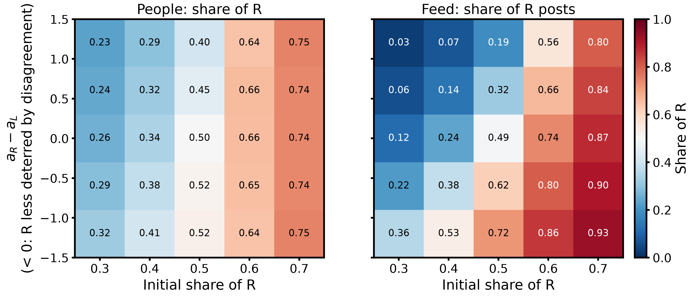
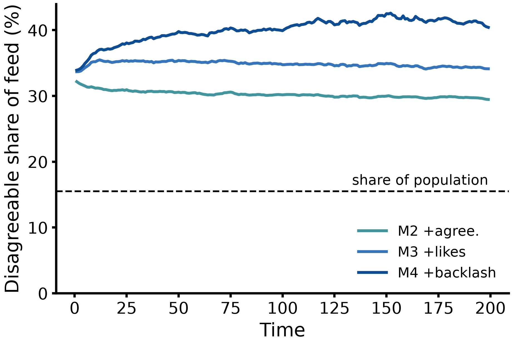
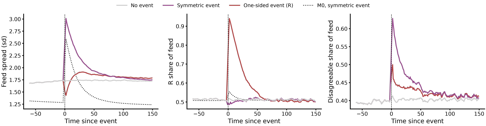

# Selection bias in online discourse

## Model

Posting rate of agent $i$:

```math
r_i = \mathrm{act}_i \, \exp\!\big(k\,|x_i| \;-\; a_i\,|x_i - n_i| \;+\; s_i\,\ell_i\big) + r_{\min}
```

Feed $F_i$: $S$ posts, a share $h$ drawn from opinion neighbours and $1-h$ from the shared feed, both with $P(j) \propto r_j$.

Perceived norm:

```math
n_i = \lambda_i \,\frac{1}{S}\sum_{j \in F_i} x_j \;+\; (1-\lambda_i)\,\frac{1}{|O_i|}\sum_{j \in O_i} x_j
```

In-group likes (a viewer likes a same-camp post bolder than their own view):

```math
\ell_i \leftarrow 0.8\,\ell_i + 0.2\,\frac{\#\{\text{viewers } v:\ \operatorname{sign}x_v=\operatorname{sign}x_i,\ |x_i|>|x_v|\}}{\#\text{views of } i}
```

Opinion update:

```math
x_i \leftarrow x_i
+ \mu\Big(\overline{x}_{\{j\in F_i:\,|x_j-x_i|<\varepsilon\}} - x_i\Big)
+ \rho_{g(i)}\,\operatorname{sign}(x_i)\,\frac{1}{S}\sum_{\substack{j\in F_i\\ \operatorname{sign}x_j\neq\operatorname{sign}x_i}} |x_j|
+ \alpha\,(x^0_i - x_i)
```

| Symbol | Meaning |
|---|---|
| $x_i$ | opinion; its sign is the camp $g(i) \in \{L, R\}$ |
| $x^0_i$ | offline opinion (initial value, real-world anchor) |
| $\mathrm{act}_i$ | baseline activity, lognormal (heavy-tailed volume) |
| $k$ | intensity selection: stronger opinions post more |
| $a_i$ | agreeability: $a>0$ quiet when far from the norm (spiral of silence), $a<0$ louder when far |
| $n_i$ | perceived norm |
| $s_i$ | status drive: sensitivity to likes |
| $\ell_i$ | recent in-group like rate |
| $r_{\min}$ | posting floor |
| $S$ | posts seen per step |
| $h$ | homophily: share of the feed from opinion neighbours |
| $\lambda_i$ | online share of attention |
| $O_i$ | random offline contacts (5) |
| $\mu$ | attraction strength toward nearby views |
| $\varepsilon$ | confidence bound: how close a view must be to attract |
| $\rho_L, \rho_R$ | backlash strength against out-group content, per camp |
| $\alpha$ | pull back toward the offline opinion |

Nested models: M0 ($a=s=\rho=0$) → M1 ($+\bar a>0$) → M2 ($+\operatorname{sd}(a)>0$) → M3 ($+s>0$) → M4 ($+\rho>0$).

## Figures

**Figure 1. Who is heard: feed vs population**


**Figure 2. Perception gap vs time online**


**Figure 3. What each mechanism adds**


**Figure 4. Committed minority**


**Figure 5. Who wins the feed**



**Figure 6. Cross-group bias**


**Figure 7. Hostility ratchet**



**Figure 8. Charged events: feed response**



**Figure 9. Charged events: opinion density**


**Figure 10. Why issues become two-party**


## References

- Bor, A., & Petersen, M. B. (2022). The psychology of online political hostility: A comprehensive, cross-national test of the mismatch hypothesis. *American Political Science Review*, 116(1), 1–18. [link](https://research.ceu.edu/en/publications/the-psychology-of-online-political-hostility-a-comprehensive-cros/)
- Yudkin, D., Hawkins, S., & Dixon, T. (2019). *The Perception Gap: How False Impressions Are Pulling Americans Apart.* More in Common. [perceptiongap.us](https://perceptiongap.us)
- Taleb, N. N. (2016). The most intolerant wins: The dictatorship of the small minority. *Incerto*. [link](https://medium.com/incerto/the-most-intolerant-wins-the-dictatorship-of-the-small-minority-3f1f83ce4e15)
- Henderson. *(reference to be completed)*
- Brady, W. J., Wills, J. A., Jost, J. T., Tucker, J. A., & Van Bavel, J. J. (2017). Emotion shapes the diffusion of moralized content in social networks. *PNAS*, 114(28), 7313–7318.
- Bail, C. A., et al. (2018). Exposure to opposing views on social media can increase political polarization. *PNAS*, 115(37), 9216–9221.
- Noelle-Neumann, E. (1974). The spiral of silence: A theory of public opinion. *Journal of Communication*, 24(2), 43–51.
- Yudkowsky, E. (2007). Evaporative cooling of group beliefs. *LessWrong*.
