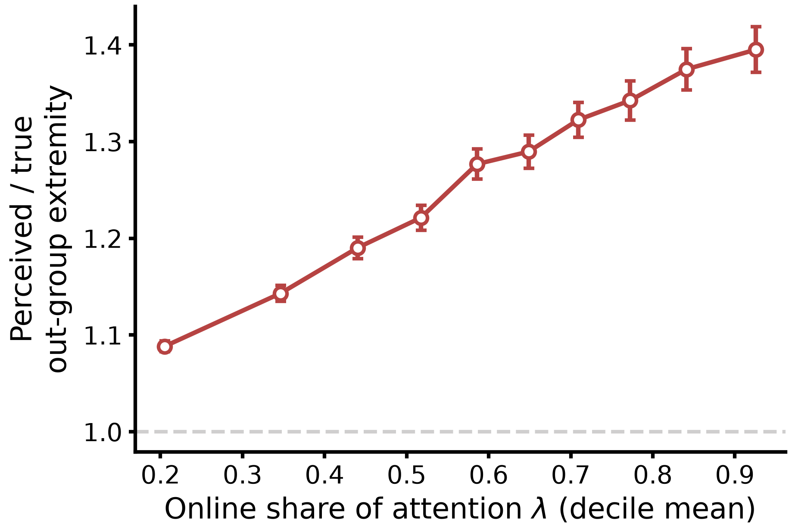
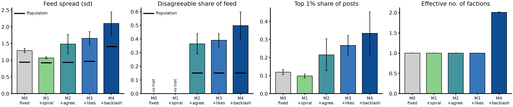
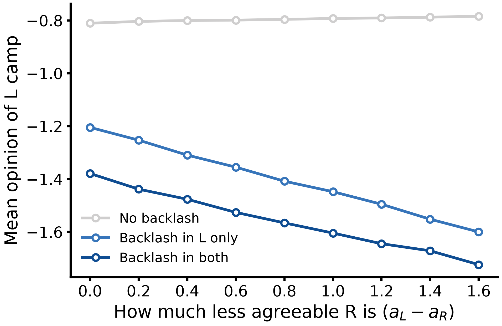
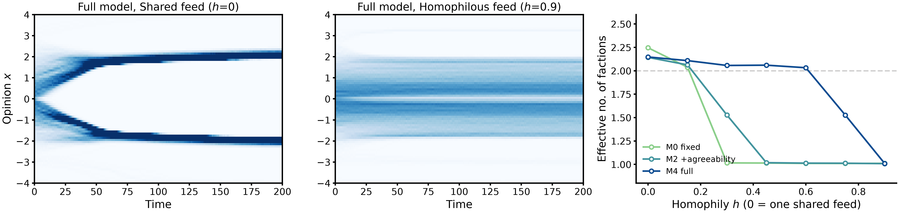

# Selection bias in online discourse

In public discourse (e.g. on X), the people who take part are, almost by definition, *the kind of people who take part*. This repo models that selection bias as a small agent-based model and shows what it does and does not explain: the gap between online and offline opinion, the perception gap, trait exaggeration, minority capture, who wins the feed, response to charged events, and two-party collapse.

## Model (`abm.py`)

Each agent *i* has an opinion $x_i$ (camp = sign), an offline opinion $x^0_i$, agreeability $a_i$, status drive $s_i$, heavy-tailed activity $\mathrm{act}_i$, and an online share of attention $\lambda_i$.

- **Posting (endogenous selection):** $\log r_i = k|x_i| - a_i\,|x_i - \text{norm}_i| + s_i\,\text{likes}_i$
  - $k|x|$: intensity selection
  - $-a_i\,d$: agreeable agents ($a>0$) go quiet when far from the perceived norm (spiral of silence, evaporative cooling); disagreeable agents ($a<0$) get louder
  - $s_i\,\text{likes}_i$: in-group reinforcement; viewers like same-camp posts bolder than their own (Brady et al.)
- **Feed:** each agent sees posts weighted by volume $r$, a share $h$ from opinion neighbours (homophily) and the rest from a shared feed.
- **Perception:** $\text{norm}_i = \lambda_i\cdot\text{feed} + (1-\lambda_i)\cdot\text{offline contacts}$.
- **Update:** attraction to nearby views + backlash against out-group content (Bail et al., per-camp strength) + pull back to $x^0_i$.

Nested models, each adding one mechanism: **M0** fixed selection → **M1** +spiral of silence → **M2** +agreeability → **M3** +in-group likes → **M4** +backlash (full).

## Run

```bash
uv run discourse_sims.py            # all experiments, < 1 min (parallel) → results/abm.npz
uv run discourse_sims.py events     # only some experiments, merged into results
uv run make_figures.py              # → figures/*.png, *.pdf
```

Requires [uv](https://docs.astral.sh/uv/) (dependencies are declared inline). Figure style follows [figures4papers](https://github.com/ChenLiu-1996/figures4papers). `legacy/` holds the earlier fixed-selection version.

## Figures

**Figure 1. Who is heard: the feed vs the population.** Opinion (left) and agreeability (right). Disagreeable agents are ~15% of people but ~50% of the feed.


**Figure 2. The perception gap grows with time spent online.** Perceived/true extremity of the out-group rises from 1.09× to 1.40× across deciles of online attention.


**Figure 3. What each mechanism adds.** Nested models M0–M4; black ticks = population values.


**Figure 4. A committed minority captures the feed, not the people.**


**Figure 5. Who wins the feed: camp size vs agreeability.** The less agreeable camp dominates the feed; the population split does not move.


**Figure 6. One camp radicalises the other through backlash.**


**Figure 7. The hostility ratchet.** Disagreeable share of the feed over time.


**Figure 8. Charged events: the feed's response.** Solid: full model; dotted: M0. Averaged over 3 seeds.


**Figure 9. Charged events: opinion density over time.**


**Figure 10. Why issues become two-party.** A shared feed yields two factions; homophily merges them unless backlash keeps them apart.


## Caveats

Parameters are hand-set, not fitted. The spike at ±4 in Figure 1 is agents piling up at the opinion cap. Figure 10's "local" feed is a chain of opinion neighbours, which favours merging.

## References

**Cited evidence**
- Bor, A., & Petersen, M. B. (2022). The psychology of online political hostility: A comprehensive, cross-national test of the mismatch hypothesis. *American Political Science Review*, 116(1), 1–18. [link](https://research.ceu.edu/en/publications/the-psychology-of-online-political-hostility-a-comprehensive-cros/)
- Yudkin, D., Hawkins, S., & Dixon, T. (2019). *The Perception Gap: How False Impressions Are Pulling Americans Apart.* More in Common. [perceptiongap.us](https://perceptiongap.us)
- Taleb, N. N. (2016). The most intolerant wins: The dictatorship of the small minority. *Incerto* (Medium); later in *Skin in the Game* (2018). [link](https://medium.com/incerto/the-most-intolerant-wins-the-dictatorship-of-the-small-minority-3f1f83ce4e15)
- Henderson. *(reference to be completed)*

**Model ingredients**
- Bail, C. A., et al. (2018). Exposure to opposing views on social media can increase political polarization. *PNAS*, 115(37), 9216–9221.
- Brady, W. J., Wills, J. A., Jost, J. T., Tucker, J. A., & Van Bavel, J. J. (2017). Emotion shapes the diffusion of moralized content in social networks. *PNAS*, 114(28), 7313–7318.
- Noelle-Neumann, E. (1974). The spiral of silence: A theory of public opinion. *Journal of Communication*, 24(2), 43–51.
- Yudkowsky, E. (2007). Evaporative cooling of group beliefs. *LessWrong*.
- Deffuant, G., Neau, D., Amblard, F., & Weisbuch, G. (2000). Mixing beliefs among interacting agents. *Advances in Complex Systems*, 3, 87–98.
- Xie, J., et al. (2011). Social consensus through the influence of committed minorities. *Physical Review E*, 84, 011130.
- Heckman, J. J. (1979). Sample selection bias as a specification error. *Econometrica*, 47(1), 153–161.
