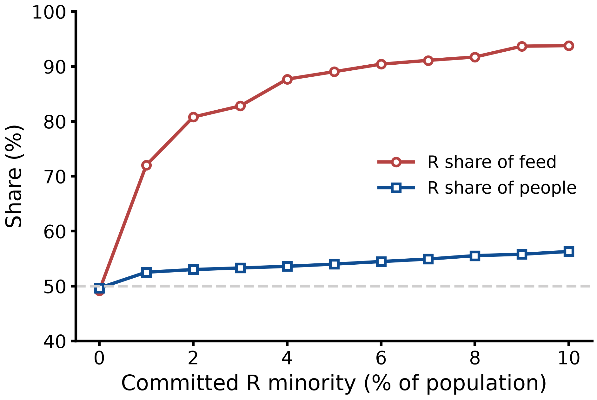
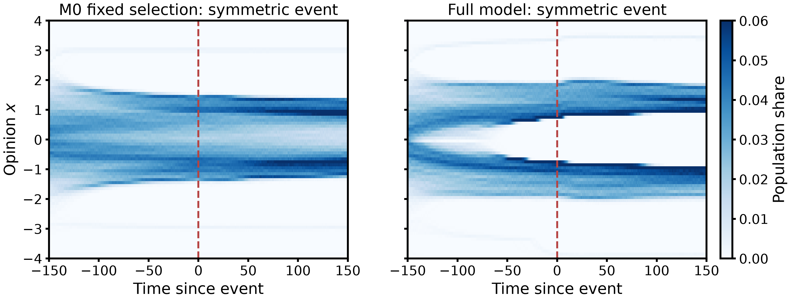

# Selection bias in online discourse

## Figures

**Figure 1. Who is heard: feed vs population**

**Figure 2. Perception gap vs time online**

**Figure 3. What each mechanism adds**

**Figure 4. Committed minority**

**Figure 5. Who wins the feed**

**Figure 6. Cross-group bias**

**Figure 7. Hostility ratchet**

**Figure 8. Charged events: feed response**

**Figure 9. Charged events: opinion density**

**Figure 10. Why issues become two-party**

## References

- Bor, A., & Petersen, M. B. (2022). The psychology of online political hostility: A comprehensive, cross-national test of the mismatch hypothesis. *American Political Science Review*, 116(1), 1–18. [link](https://research.ceu.edu/en/publications/the-psychology-of-online-political-hostility-a-comprehensive-cros/)
- Yudkin, D., Hawkins, S., & Dixon, T. (2019). *The Perception Gap: How False Impressions Are Pulling Americans Apart.* More in Common. [perceptiongap.us](https://perceptiongap.us)
- Taleb, N. N. (2016). The most intolerant wins: The dictatorship of the small minority. *Incerto*. [link](https://medium.com/incerto/the-most-intolerant-wins-the-dictatorship-of-the-small-minority-3f1f83ce4e15)
- Henderson. *(reference to be completed)*
- Brady, W. J., Wills, J. A., Jost, J. T., Tucker, J. A., & Van Bavel, J. J. (2017). Emotion shapes the diffusion of moralized content in social networks. *PNAS*, 114(28), 7313–7318.
- Bail, C. A., et al. (2018). Exposure to opposing views on social media can increase political polarization. *PNAS*, 115(37), 9216–9221.
- Noelle-Neumann, E. (1974). The spiral of silence: A theory of public opinion. *Journal of Communication*, 24(2), 43–51.
- Yudkowsky, E. (2007). Evaporative cooling of group beliefs. *LessWrong*.
