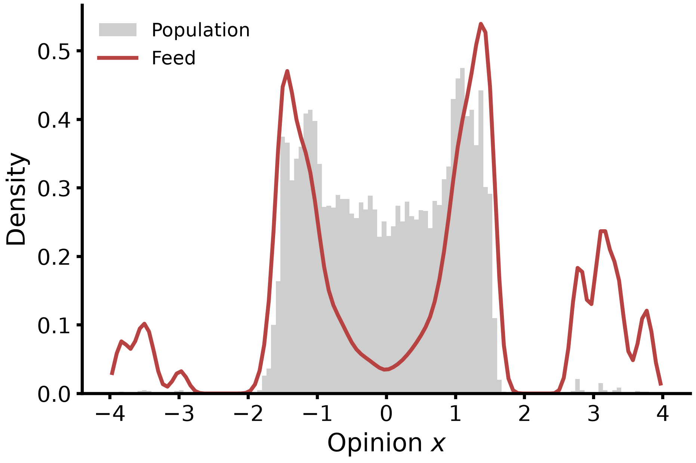
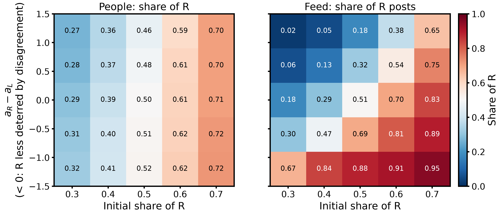
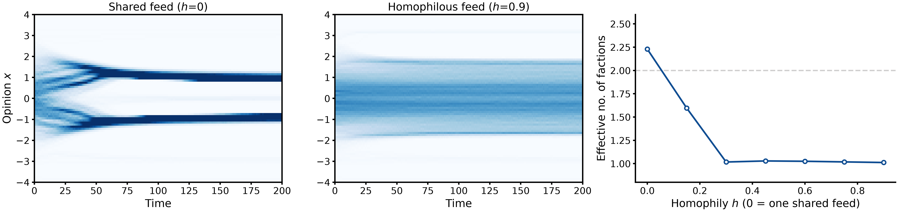
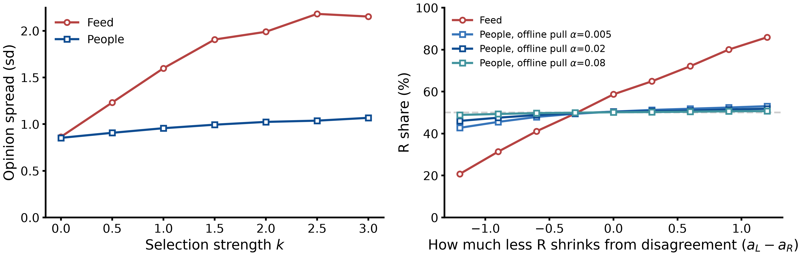

# Selection bias in online discourse

## Model

```math
r_i = \mathrm{act}_i \, e^{\,k|x_i| \,-\, a_i |x_i - n_i|}
```

```math
n_i = \lambda_i \, \bar{x}_{\mathrm{feed}} + (1-\lambda_i)\, \bar{x}_{\mathrm{offline}}
```

```math
x_i \leftarrow x_i + \mu\,(\bar{x}_{\mathrm{near}} - x_i) + \alpha\,(x^0_i - x_i)
```

- $r_i$: how much agent $i$ posts; the feed samples posts in proportion to $r$
- $x_i$: opinion ($x^0_i$: offline opinion); $\mathrm{act}_i$: heavy-tailed activity
- $k$: strong opinions post more
- $a_i$: spiral of silence; agents far from the perceived norm $n_i$ go quiet
- $\lambda_i$: share of attention spent online
- $\bar{x}_{\mathrm{near}}$: mean of seen posts close to one's own view; $\mu$: pull toward them
- $\alpha$: pull back toward the offline opinion

## Figures

**Figure 1. Who is heard: feed vs population**



**Figure 2. Perception gap vs time online**


**Figure 3. Who wins the feed**



**Figure 4. Why issues become two-party**



**Figure 5. The feed moves, people barely do**



## References

- Bor, A., & Petersen, M. B. (2022). The psychology of online political hostility: A comprehensive, cross-national test of the mismatch hypothesis. *American Political Science Review*, 116(1), 1–18. [link](https://research.ceu.edu/en/publications/the-psychology-of-online-political-hostility-a-comprehensive-cros/)
- Yudkin, D., Hawkins, S., & Dixon, T. (2019). *The Perception Gap: How False Impressions Are Pulling Americans Apart.* More in Common. [perceptiongap.us](https://perceptiongap.us)
- Taleb, N. N. (2016). The most intolerant wins: The dictatorship of the small minority. *Incerto*. [link](https://medium.com/incerto/the-most-intolerant-wins-the-dictatorship-of-the-small-minority-3f1f83ce4e15)
- Henderson. *(reference to be completed)*
- Brady, W. J., Wills, J. A., Jost, J. T., Tucker, J. A., & Van Bavel, J. J. (2017). Emotion shapes the diffusion of moralized content in social networks. *PNAS*, 114(28), 7313–7318.
- Bail, C. A., et al. (2018). Exposure to opposing views on social media can increase political polarization. *PNAS*, 115(37), 9216–9221.
- Noelle-Neumann, E. (1974). The spiral of silence: A theory of public opinion. *Journal of Communication*, 24(2), 43–51.
- Yudkowsky, E. (2007). Evaporative cooling of group beliefs. *LessWrong*.
- Guess, A. M., et al. (2023). How do social media feed algorithms affect attitudes and behavior in an election campaign? *Science*, 381(6656), 398–404. [doi](https://doi.org/10.1126/science.abp9364)
- Guess, A. M., et al. (2023). Reshares on social media amplify political news but do not detectably affect beliefs or opinions. *Science*, 381(6656), 404–408. [doi](https://doi.org/10.1126/science.add8424)
- Nyhan, B., et al. (2023). Like-minded sources on Facebook are prevalent but not polarizing. *Nature*, 620, 137–144. [doi](https://doi.org/10.1038/s41586-023-06297-w)
- Grinberg, N., Joseph, K., Friedland, L., Swire-Thompson, B., & Lazer, D. (2019). Fake news on Twitter during the 2016 U.S. presidential election. *Science*, 363(6425), 374–378. [doi](https://doi.org/10.1126/science.aau2706)
